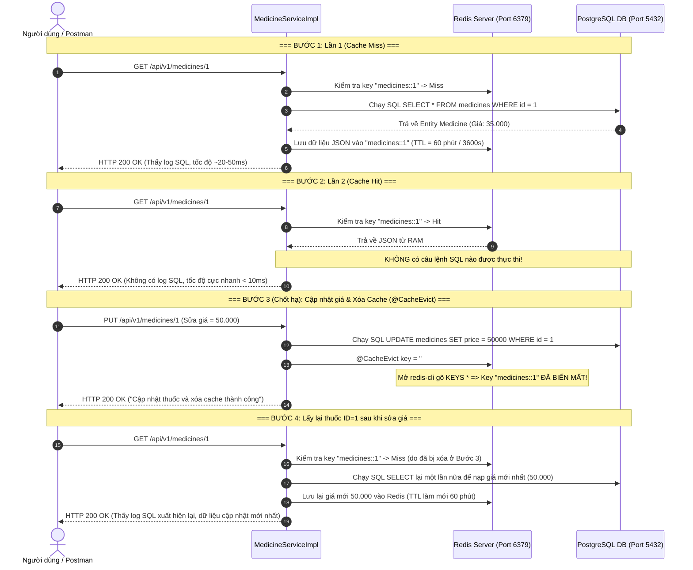
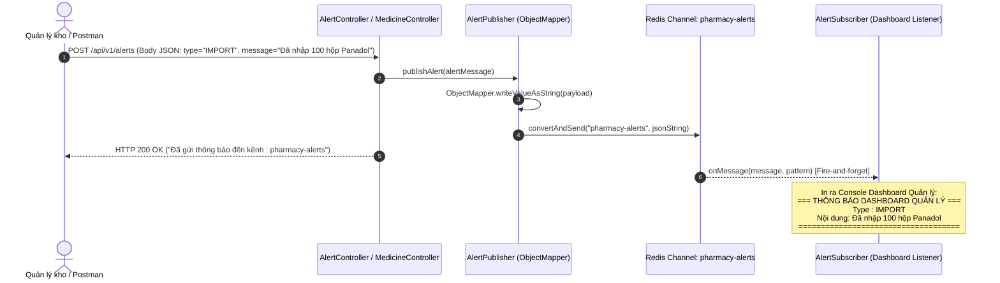

# [Bài tập] Hệ Thống Quản Lý Danh Mục Thuốc (Redis Cache, TTL & Pub/Sub)

Hệ thống quản lý, Caching danh mục thuốc và thông báo Real-time cho hiệu thuốc lớn, xây dựng trên nền tảng **Spring Boot 3.3.5**, **Spring Data Redis**, và **PostgreSQL**, tích hợp đầy đủ 3 cơ chế quan trọng:
1. **Cache-aside Pattern**: Tăng tốc truy vấn danh mục thuốc, giảm tải cho Database.
2. **Quản lý vòng đời TTL (60 phút) & Cache Eviction**: Tự động xóa cache khi giá thuốc thay đổi để tránh dữ liệu cũ (Stale Data).
3. **Redis Pub/Sub (Publish - Subscribe)**: Phát thông báo nhập hàng (Import) tức thì đến tất cả màn hình Dashboard quản lý chi nhánh theo cơ chế Fire-and-forget.

---

## 1. Mục tiêu & Yêu cầu Kỹ thuật

| Bài tập | Nội dung chính | Yêu cầu kỹ thuật đạt được |
|---|---|---|
| **Bài 1: Caching Danh Mục Thuốc** | Tăng tốc độ đọc dữ liệu chi tiết thuốc | `@Cacheable(value = "medicines", key = "#id")`, lưu trữ dạng JSON trong Redis, giảm thời gian phản hồi từ ~50ms xuống `< 10ms` (thực tế: **2ms**). |
| **Bài 2: Đồng bộ Dữ liệu & TTL** | Xóa cache khi cập nhật giá, TTL 60 phút | Cấu hình TTL **60 phút** (`3600000ms`), `@CacheEvict(value = "medicines", key = "#medicine.id")` xóa key ngay khi thuốc được sửa giá. |
| **Bài 3: Thông báo Pub/Sub** | Thông báo nhập hàng đến Dashboard quản lý | **Publisher**: gửi JSON message vào channel `pharmacy-alerts`. **Subscriber**: lắng nghe và in ra console formatted block. Hỗ trợ gửi đối tượng qua `ObjectMapper`. |

---

## 2. Kiến trúc Luồng Xử Lý (Sequence Diagram)

### 2.1. Luồng Cache-aside & Cache Eviction (Bài 1 & Bài 2)


### 2.2. Luồng Thông Báo Real-time Redis Pub/Sub (Bài 3)


---

## 3. Cấu hình Cốt lõi trong `application.yaml`
Toàn bộ thông số hỗ trợ ghi đè qua **Biến Global (Environment Variables)**:

```yaml
server:
  port: ${SERVER_PORT:8080}

spring:
  application:
    name: ${SPRING_APPLICATION_NAME:medicine-service}

  datasource:
    url: ${SPRING_DATASOURCE_URL:jdbc:postgresql://${DB_HOST:localhost}:${DB_PORT:5432}/${DB_NAME:medicine_db}}
    username: ${SPRING_DATASOURCE_USERNAME:postgres}
    password: ${SPRING_DATASOURCE_PASSWORD:123456}
    driver-class-name: org.postgresql.Driver

  jpa:
    database-platform: org.hibernate.dialect.PostgreSQLDialect
    hibernate:
      ddl-auto: ${JPA_DDL_AUTO:update}
    show-sql: ${SHOW_SQL:true}
    properties:
      hibernate:
        format_sql: true
        highlight_sql: true
    open-in-view: false

  cache:
    type: ${CACHE_TYPE:redis}
    redis:
      # TTL 60 phut cho cache medicines (3.600.000 ms = 3.600s)
      time-to-live: ${CACHE_REDIS_TTL:3600000}
      cache-null-values: false
      use-key-prefix: true
      key-prefix: ${CACHE_REDIS_KEY_PREFIX:medicines::}

  data:
    redis:
      host: ${REDIS_HOST:localhost}
      port: ${REDIS_PORT:6379}
      timeout: ${REDIS_TIMEOUT:60000ms}

logging:
  level:
    org:
      hibernate:
        SQL: ${LOG_HIBERNATE_SQL:DEBUG}
        orm:
          jdbc:
            bind: ${LOG_HIBERNATE_BIND:TRACE}
      springframework:
        cache: ${LOG_SPRING_CACHE:DEBUG}
    com:
      medical:
        medicine: ${LOG_APP_LEVEL:DEBUG}
```

---

## 4. Hướng dẫn Thực hành Kiểm chứng Từng Bài Tập

### 4.1. Bài 1 & 2: Caching, TTL 60 phút & Cache Eviction

- **Bước 1 (Lần 1 - Cache Miss)**:
  ```http
  GET http://localhost:8080/api/v1/medicines/1
  ```
  - Console hiện câu lệnh SQL: `select m1_0.id, m1_0.name... from medicines m1_0 where m1_0.id=?`.
  - Dữ liệu nạp vào Redis key `medicines::1` với TTL **60 phút** (`redis-cli TTL "medicines::1"` trả về `~3595` giây).
- **Bước 2 (Lần 2 - Cache Hit)**:
  ```http
  GET http://localhost:8080/api/v1/medicines/1
  ```
  - Console **hoàn toàn không có SQL**.
  - Tốc độ cực nhanh: **~2ms** (< 10ms).
- **Bước 3 (Chốt hạ - Update giá thuốc)**:
  ```http
  PUT http://localhost:8080/api/v1/medicines/1
  Content-Type: application/json

  {
    "name": "Panadol Extra",
    "code": "MED-001",
    "category": "Giam dau - Ha sot",
    "price": 50000.00,
    "dosage": "Paracetamol 500mg, Caffeine 65mg",
    "description": "Thuoc giam dau, ha sot gia moi",
    "manufacturer": "GlaxoSmithKline (GSK)"
  }
  ```
  - Mở terminal gõ `redis-cli KEYS *` 👉 **Key `medicines::1` đã bị xóa ngay lập tức!**
- **Bước 4 (Gọi lại sau khi sửa giá)**:
  ```http
  GET http://localhost:8080/api/v1/medicines/1
  ```
  - Console xuất hiện câu lệnh SQL lại một lần nữa.
  - Giá trả về đã được cập nhật thành **`50000.00`**.
  - Cache được tạo lại trong Redis với TTL 60 phút mới.

---

### 4.2. Bài 3: Gửi Thông Báo Redis Pub/Sub đến Dashboard Quản Lý

#### Cách 1: Gửi qua Endpoint Alerts (Như hình ảnh Postman)
- **Phương thức**: `POST`
- **URL**: `http://localhost:8080/api/v1/alerts`
- **Headers**: `Content-Type: application/json`
- **Body**:
  ```json
  {
    "topicListen" : "pharmacy-alerts",
    "type" : "IMPORT",
    "message" : "Đã nhập 100 hộp Panadol"
  }
  ```
- **Response trả về**:
  ```text
  Đã gửi thông báo đến kênh : pharmacy-alerts
  ```

#### Cách 2: Gọi trực tiếp API Nhập hàng Thuốc
- **Phương thức**: `POST`
- **URL**: `http://localhost:8080/api/v1/medicines/1/import?quantity=100`

#### Kết quả hiển thị trên Console Server:
```text
2026-11-06T21:26:14.063+07:00  INFO 13804 --- [nio-8080-exec-2] c.m.medicine.pubsub.AlertPublisher       : Publisher da gui thong bao thanh cong den channel 'pharmacy-alerts': {"type":"IMPORT","message":"Đã nhập 100 hộp Panadol"}
=== THÔNG BÁO DASHBOARD QUẢN LÝ ===
Type : IMPORT
Nội dung: Đã nhập 100 hộp Panadol
====================================
2026-11-06T21:26:14.067+07:00  INFO 13804 --- [enerContainer-1] c.m.medicine.pubsub.AlertSubscriber      : Subscriber da nhan tin nhan tu channel 'pharmacy-alerts': type=IMPORT, message=Đã nhập 100 hộp Panadol
```

---

## 5. Danh Sách Đầy Đủ API Endpoints

| STT | Phương thức | Endpoint | Chức năng | Cơ chế Redis |
|---|---|---|---|---|
| 1 | `GET` | `/api/v1/medicines/{id}` | Lấy chi tiết thuốc theo ID | `@Cacheable` (TTL 60 phút) |
| 2 | `PUT` | `/api/v1/medicines/{id}` | Cập nhật thông tin/giá thuốc | `@CacheEvict` (Xóa cache cũ) |
| 3 | `POST` | `/api/v1/medicines/{id}/import?quantity=100` | Nhập thêm hàng thuốc | Tự động phát Redis Pub/Sub |
| 4 | `POST` | `/api/v1/alerts` | Gửi cảnh báo Dashboard | Redis Pub/Sub Channel |
| 5 | `GET` | `/api/v1/medicines` | Xem toàn bộ danh mục thuốc | Query Database |
| 6 | `POST` | `/api/v1/medicines` | Thêm mới thuốc | Query Database |
| 7 | `DELETE`| `/api/v1/medicines/{id}` | Xóa thuốc khỏi hệ thống | `@CacheEvict` |

**Swagger UI Docs**: `http://localhost:8080/swagger-ui.html`

---

## 6. Kiểm Thử Tự Động Toàn Diện
Chạy toàn bộ test suite (bao gồm Unit Test, Integration Test Caching và Integration Test Pub/Sub):
```powershell
.\gradlew.bat test
```
*Kết quả: **100% Passed**.*
